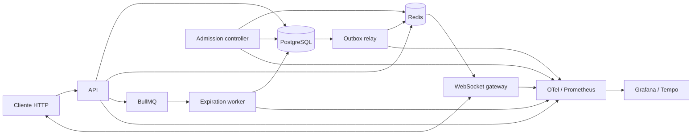
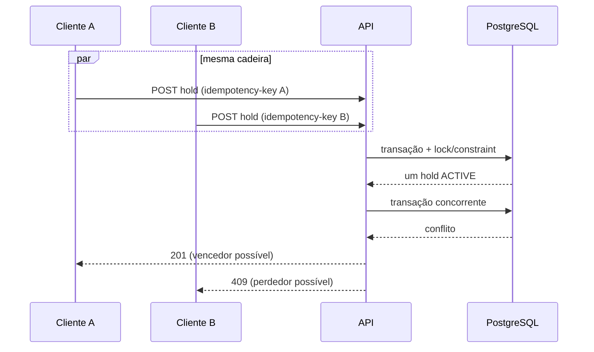
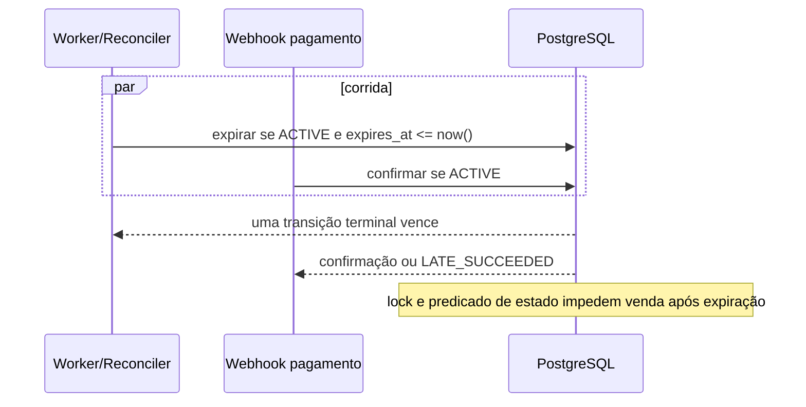

# Arquitetura

O sistema é um monólito modular distribuído em processos especializados. PostgreSQL é a
fonte da verdade das reservas; Redis é deliberadamente descartável para fila, jobs e
broadcast. Todos os comandos críticos terminam em constraints e transações no PostgreSQL.



## Processos e escala

| Processo             | Estado essencial para readiness | Unidade de escala          |
| -------------------- | ------------------------------- | -------------------------- |
| API                  | PostgreSQL e Redis              | requisições HTTP           |
| WebSocket gateway    | Redis subscriber                | conexões persistentes      |
| Expiration worker    | PostgreSQL e Redis/BullMQ       | jobs e atraso de expiração |
| Outbox relay         | PostgreSQL e Redis              | backlog da outbox          |
| Admission controller | PostgreSQL e Redis              | tamanho/tempo da fila      |
| migrate / seed       | PostgreSQL                      | jobs one-shot de deploy    |

API, relay, worker e controlador podem ter múltiplas réplicas. `FOR UPDATE SKIP LOCKED`,
scripts Lua, transições condicionais e idempotência tornam a coordenação segura. O gateway
é stateless em relação ao estado autoritativo; reconexões recuperam snapshots pela API.

## Sequências críticas

### Hold concorrente



### Confirmação, outbox e broadcast

```mermaid
sequenceDiagram
  participant C as Cliente
  participant API
  participant DB as PostgreSQL
  participant R as Outbox relay
  participant Redis
  participant WS as WebSocket gateway
  C->>API: confirmar hold
  API->>DB: UPDATE hold/seat + INSERT outbox (uma transação)
  DB-->>API: commit
  API-->>C: confirmado
  R->>DB: SELECT FOR UPDATE SKIP LOCKED
  R->>Redis: publish eventId/version
  Redis->>WS: evento
  WS-->>C: seat.updated
  R->>DB: marca publicado
  Note over R,DB: queda antes da marca pode republicar; consumidores deduplicam
```

### Expiração versus pagamento


