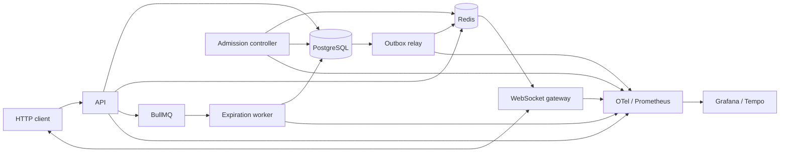
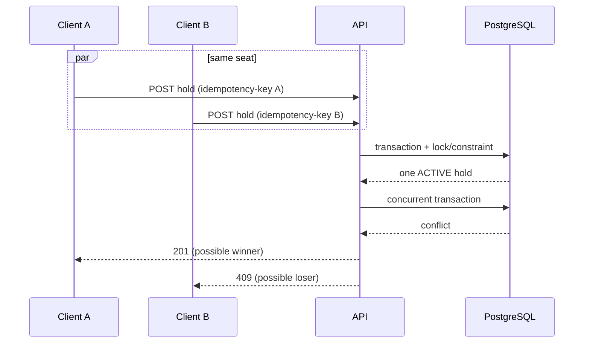
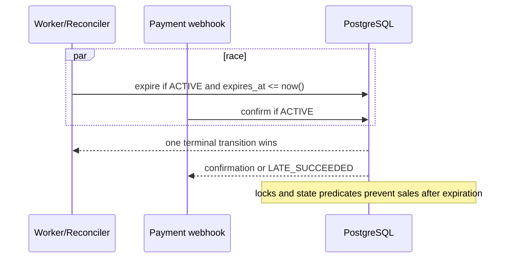

# Architecture

The system is a modular monolith distributed across specialized processes. PostgreSQL is the source of truth for reservations; Redis is deliberately disposable and supports queues, jobs, and broadcasts. Every critical command ultimately relies on PostgreSQL transactions and constraints.



## Processes and scaling

| Process              | Essential readiness state   | Scaling unit              |
| -------------------- | --------------------------- | ------------------------- |
| API                  | PostgreSQL and Redis        | HTTP requests             |
| WebSocket gateway    | Redis subscriber            | persistent connections    |
| Expiration worker    | PostgreSQL and Redis/BullMQ | jobs and expiration delay |
| Outbox relay         | PostgreSQL and Redis        | outbox backlog            |
| Admission controller | PostgreSQL and Redis        | queue size/wait time      |
| migrate / seed       | PostgreSQL                  | one-shot deployment jobs  |

The API, relay, worker, and controller can run multiple replicas. `FOR UPDATE SKIP LOCKED`, Lua scripts, conditional transitions, and idempotency provide safe coordination. The gateway is stateless with respect to authoritative data; reconnecting clients recover snapshots through the API.

## Critical sequences

### Concurrent hold



### Confirmation, outbox, and broadcast

```mermaid
sequenceDiagram
  participant C as Client
  participant API
  participant DB as PostgreSQL
  participant R as Outbox relay
  participant Redis
  participant WS as WebSocket gateway
  C->>API: confirm hold
  API->>DB: UPDATE hold/seat + INSERT outbox (one transaction)
  DB-->>API: commit
  API-->>C: confirmed
  R->>DB: SELECT FOR UPDATE SKIP LOCKED
  R->>Redis: publish eventId/version
  Redis->>WS: event
  WS-->>C: seat.updated
  R->>DB: mark as published
  Note over R,DB: a crash before marking may republish; consumers deduplicate
```

### Expiration versus payment


